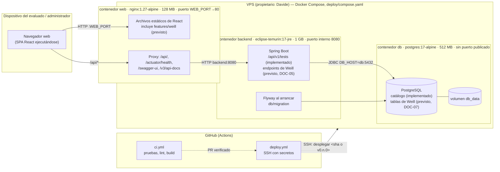

# S02-WEI-DOC-14 — Vista física: integración y despliegue (módulo Weill)

| Campo | Valor |
| --- | --- |
| Código | S02-WEI-DOC-14 · versión v01 (borrador para revisión) |
| Fecha | 24/11/2026 |
| Autor | Diego Martínez (con Alejandra Morales; reparto según la tarea) |
| Base | `compose.yaml`, `deploy/*`, `.github/workflows/*`, `backend/src/main/resources/application.yml`, `docs/equipos/CONFIGURACION-GITHUB.md` (estado del repositorio al 23/11/2026) |
| Revisión independiente | **Pendiente.** No se autoaprueba. |

## 1. Alcance y regla de lectura

Este documento ubica el módulo Weill dentro de la infraestructura **que ya existe en el repositorio**. No se agregan nodos, servicios, colas, cachés ni balanceadores. Cada elemento se marca así:

- **Implementado:** está en un archivo del repositorio (se cita el archivo).
- **Propuesto:** surge de documentos del sprint y aún no existe en el repositorio.
- **Por confirmar:** depende de un dato que no está en el repositorio (VPS, TLS, dominio, respaldos).

Weill **no tiene despliegue propio**. Es código (React, Spring Boot) y tablas (PostgreSQL) dentro de los mismos contenedores que el resto del sistema. Hoy no hay lógica de Weill en el backend ni migraciones de Weill: el backend solo expone el catálogo de tests (`/api/v1/tests`) y la carpeta `frontend/src/features/weill/` solo tiene un README. Todo lo de Weill en esta vista es, por tanto, **ubicación prevista** dentro de lo implementado.

## 2. Diagrama de despliegue

El archivo editable en Enterprise Architect (EA) no se generó aquí: esta sesión no puede crear ni abrir archivos `.eap/.qea`. El diagrama de abajo está en Mermaid para pasarlo a EA con los mismos nodos, estereotipos y relaciones.

## 3. Inventario de componentes

| Componente | Tipo | Estado | Dónde se define | Rol para Weill |
| --- | --- | --- | --- | --- |
| Navegador del evaluado | Nodo cliente | Implementado (ejecuta la SPA) | — | Muestra inicio, láminas, cierre (DOC-10) |
| `web` (Nginx 1.27 + SPA compilada) | Contenedor | Implementado | `deploy/frontend.Dockerfile`, `deploy/nginx.conf` | Sirve la UI de Weill y reenvía `/api/` |
| `backend` (Spring Boot, Java 17) | Contenedor | Implementado | `deploy/backend.Dockerfile` | Alojará casos de uso, evaluador y controladores de Weill |
| `db` (PostgreSQL 17) | Contenedor | Implementado | `deploy/compose.yaml` | Alojará las tablas de Weill |
| Volumen `db_data` | Almacenamiento | Implementado | `deploy/compose.yaml` | Persistencia de las respuestas |
| Migraciones Flyway | Artefacto | Implementado (solo catálogo) | `database/migrations` empaquetadas en el JAR (`backend/pom.xml`) | Las tablas de Weill llegarán por aquí |
| Entorno `main` | Entorno | Implementado, despliegue automático al fusionar | `deploy.yml`, `CONFIGURACION-GITHUB.md` §5 | Integración continua del módulo |
| Entorno `release` | Entorno | Preparado; **sin versión publicada** | igual | Entrega a producción; etiqueta `v0.<semana>.0` con visto bueno |
| Desarrollo local | Entorno | Implementado | `compose.yaml` raíz (solo PostgreSQL, puerto 127.0.0.1) | Backend y frontend corren fuera de contenedores |
| Autenticación con token Bearer | Control de acceso | **Propuesto** (reglas del sprint) | no existe en el código | Protegerá los endpoints de Weill |
| TLS, dominio, respaldos de la base | Infraestructura | **Por confirmar** | no están en el repositorio | — |

## 4. Flujos de datos

1. **Carga de la interfaz:** navegador → `web:80` (archivos estáticos; cualquier ruta que no sea `/api` devuelve `index.html`, por lo que `/weill/...` lo resuelve el enrutador de React).
2. **Llamadas de la aplicación:** navegador → `/api/*` en Nginx → `backend:8080`. Las rutas de Weill pertenecerán a `/api/v1/...` según el contrato de DOC-05 (aún por cerrar).
3. **Persistencia:** backend → `db:5432` por JDBC. Las respuestas del evaluado y los eventos de auditoría se guardan solo aquí; el navegador no accede a la base.
4. **Migraciones:** al arrancar, Flyway aplica `db/migration` y Hibernate solo **valida** (`ddl-auto: validate`); no crea tablas.
5. **Observabilidad:** `/actuator/health` y `/swagger-ui` salen por Nginx; Actuator expone solo `health` e `info`.
6. **Despliegue:** merge a `main` → `ci.yml` (backend `mvn verify`, frontend lint/format/typecheck/test/build) → `deploy.yml` ejecuta por SSH el comando `desplegar <sha>` en el VPS. En `release`, `desplegar v0.<semana>.0`.

## 5. Configuración y controles de acceso

| Tema | Estado actual (implementado) | Pendiente / propuesto |
| --- | --- | --- |
| Variables de base | `POSTGRES_DB/USER/PASSWORD`, `DB_HOST`, `POSTGRES_PORT`, `SERVER_PORT` por entorno; valores reales fuera del repositorio | — |
| Secretos | `VPS_HOST`, `VPS_KNOWN_HOSTS`, `VPS_SSH_KEY` en GitHub Actions; `.env` prohibido por el CI | Rotación de clave SSH la confirma el dueño del VPS |
| Exposición de red | Solo `web` publica puerto (`WEB_PORT`); `db` y `backend` solo en la red interna de Compose | TLS y dominio: por confirmar |
| Recursos | `db` 512 MB, `backend` 1 GB, `web` 128 MB | Dimensionar con la carga real de Weill: por confirmar |
| Salud y orden | `db` con healthcheck; `backend` espera a `db` sano | Sin healthcheck en `backend` y `web` en Compose |
| Seguridad en backend | Adaptador `AutorizacionContenidoDenegadaAdapter` (perfil `!seguridad-integrada`) deniega por defecto la edición de contenido | Integración de cuentas, sesiones y token Bearer sin JWT (PR #89 de cuenta/sesión sin fusionar) |
| Operación peligrosa | `reiniciar-bd` solo en `main`, solo el propietario, con `ALLOW_DB_RESET=true` y confirmación | Mantener desactivada; nunca en `release` |
| Datos | Solo datos ficticios en pruebas y entornos | No cargar sujetos reales sin acuerdo de privacidad |

## 6. Diferencia entre lo actual y lo propuesto

- **Actual:** tres contenedores (`web`, `backend`, `db`), CI, despliegue a `main` verificado, catálogo de tests expuesto por `/api/v1/tests`.
- **Propuesto para Weill, sin infraestructura nueva:** pantallas en `features/weill`, casos de uso en `application`, tablas por Flyway, endpoints según DOC-05, token Bearer.
- **No propuesto:** servidores, colas, microservicios, almacenamiento de archivos ni CDN. Si el recurso visual de las láminas requiere almacenamiento de imágenes, es una **decisión abierta** (dónde se alojan y quién autoriza el material), no una pieza ya diseñada.

## 7. Riesgos y decisiones pendientes

| Id | Riesgo o decisión | Responsable sugerido |
| --- | --- | --- |
| R-01 | `release` aún no tiene versión; Weill no se puede validar fuera de `main` | Integración / Testing |
| R-02 | Sin copia de seguridad verificada de `db_data` documentada: perder el volumen pierde respuestas | Dueño del VPS |
| R-03 | Sin TLS visible en el repositorio: el token Bearer viajaría en claro si no lo termina el VPS | Dueño del VPS |
| R-04 | Sin autenticación real: los endpoints de Weill no deben publicarse hasta integrar cuenta y sesión | Desarrollo / Integración |
| R-05 | Recursos de 1 GB para el backend no medidos con sesiones simultáneas | Testing |
| D-01 | Alojamiento de las imágenes de láminas | Psicología + Integración |
| D-02 | Si el tiempo límite (H-01) se controla en servidor o cliente cambia qué dato se guarda y dónde | Psicología + Desarrollo |

## 8. Dependencias y verificación

- Coherencia con 03 (requisitos no funcionales), 09, 13 y base DOC-12: **por contrastar** cuando esos documentos estén publicados; este borrador se apoya solo en el repositorio.
- Criterio «coincide con la infraestructura real»: cada fila marcada Implementado se verificó contra el archivo citado. Lo que dice el VPS (versión de Docker, SO, dominio, respaldos) **no se verificó** porque no está en el repositorio.

## 9. Fuentes

`compose.yaml`; `deploy/compose.yaml`, `deploy/backend.Dockerfile`, `deploy/frontend.Dockerfile`, `deploy/nginx.conf`; `.github/workflows/ci.yml` y `deploy.yml`; `backend/src/main/resources/application.yml`; `backend/pom.xml`; `database/README.md`; `docs/equipos/CONFIGURACION-GITHUB.md` §5; `docs/arquitectura/README.md`; controlador `CatalogoTestsController`; texto de la tarea S02-WEI-DOC-14 en ClickUp.
