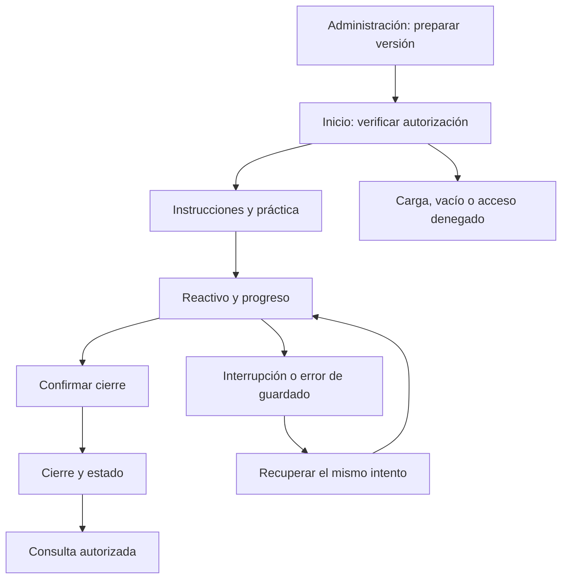

# S02-WEI-DOC-10 · Mapa de navegación y validación del prototipo

**Responsable del aporte:** Javier Josué Espinoza Blandón  
**Fecha:** 27/11/2026  
**Base:** [PR #100](https://github.com/Nell16/sistema-evaluaciones/pull/100), commit `2b379a5`, [ClickUp](https://app.clickup.com/t/90141806675/1k5fzqazdpx), [editables y documentación del sprint](https://drive.google.com/drive/folders/1XY4EOjPUWazC2AoPTbcw7UQ6xth6A1Lj).

El prototipo existente cubre inicio, instrucciones, reactivo y cierre. Usa datos de demostración y conserva la selección en memoria durante la ejecución. El mapa amplía la cobertura documental con estados de administración, recuperación y resultados. Las pantallas y transiciones marcadas como propuestas son criterios para la siguiente iteración.

| Pantalla | Requisitos y operaciones de referencia | Evidencia en #100 | Validación esperada |
| --- | --- | --- | --- |
| Administración | WEI-RF-001, 013 · E25–E31 | No incluida | Diferenciar versión en borrador de publicada y comunicar restricciones de edición por permisos. |
| Inicio | WEI-RF-003 · E3 | Formulario local | Mantener el foco en el primer error, avisar de campos faltantes y evitar doble envío. |
| Instrucciones y práctica | WEI-RF-002 · E24, E5 | Instrucciones de demostración | Distinguir la práctica de la evaluación. Mantener pendiente el texto autorizado. |
| Reactivo y progreso | WEI-RF-005, 007 · E6, E7 | Vista por lámina y selección local | Navegar con teclado, anunciar posición y selección, comunicar guardado y excluir la clave de la interfaz. |
| Recuperación | WEI-RF-008, 009 · E4, E7 | No incluida | Recuperar el mismo intento y sus respuestas confirmadas. Diferenciar una selección pendiente de una guardada. |
| Cierre | WEI-RF-010 · E8 | Pantalla de fin local | Confirmar el envío y mostrar un recibo de cierre. Tratar omisiones según reglas versionadas y validadas. |
| Resultados | WEI-RF-014 · E9, E12 | No incluida | Representar cálculo, validación y publicación. Aplicar permisos y alcance antes de mostrar información. |

## Escenarios para validar

| Escenario con datos sintéticos | Resultado esperado |
| --- | --- |
| Catálogo sin versión disponible o petición fallida | Estado vacío o error con acción de volver o reintentar. |
| Pérdida de conexión durante el guardado | Selección visible como pendiente. El reintento evita duplicación y recupera el estado del servidor. |
| Solicitud de cierre repetida | Una sola transición y confirmación del cierre persistido. |
| Resultado pendiente o acceso denegado | Estado explícito, sin puntajes ni información restringida. |
| Uso sin ratón o lector de pantalla | Orden y foco visibles, controles con nombres accesibles, progreso y error anunciados sin depender del color. |

## Validación funcional ejecutada

**Fecha:** 27/11/2026. **Entorno:** Chromium en modo sin interfaz, con la compilación del [PR #100](https://github.com/Nell16/sistema-evaluaciones/pull/100) fijada al commit `2b379a551174eb2ec2fb2eca2ce02629101ed032`, ruta `/weill/prototipo` y datos ficticios. Se verificaron interacciones y resultados visibles mediante Playwright.

| Verificación | Resultado observado |
| --- | --- |
| Inicio e instrucciones | El botón de inicio está deshabilitado con los campos vacíos. Con los tres campos completos se muestran las instrucciones y «Comenzar» abre la primera posición. |
| Secuencia | Se recorrieron las 60 posiciones de las cinco láminas. Cada posición presentó ocho opciones y se verificó la selección antes de avanzar. |
| Omisión y cierre | Se avanzó sin seleccionar en una posición y se llegó al cierre con 59 selecciones de 60. Es el comportamiento observado del prototipo y la regla funcional de omitidos sigue pendiente de validación. |
| Reinicio y recarga | «Volver al inicio» vacía el formulario. Un intento nuevo empieza sin selección y una recarga durante la aplicación vuelve al inicio. |
| Entorno de prueba | No se observaron errores de página ni solicitudes fetch/XHR durante el recorrido. `npm run typecheck`, `npm test` (115/115) y `npm run build` finalizaron correctamente. |

**Pendiente para la entrega integral:** cotejar una edición final aprobada con la matriz, comprobar la gestión de foco y el lector de pantalla, y validar administración, permisos, persistencia, recuperación, errores de API y resultados cuando exista una versión integrada. La prueba de ejecución respalda el flujo local de aplicación; la revisión funcional y técnica independiente sigue pendiente.

El PR #100 conserva su propia revisión y una observación sobre la convención de nombres de rama.

## Cotejo de los wireframes v01

Se inspeccionaron las siete láminas HTML y el manifiesto del [ZIP editable del sprint](https://drive.google.com/file/d/1BE2Uh49OYHF9rPXEz9FFiKBezERUTeor/view?usp=drive_link). El mapa y la tabla pantalla–RF cubren inicio e instrucciones (W01–W02), reactivo y estados de recuperación (W03–W04), cierre y resultados (W05–W06) y administración (W07). El diseño de guardado, recuperación, resultados y administración describe el flujo previsto. En el prototipo verificado, el guardado es local a la sesión y la recarga pierde el avance.

La prueba con teclado comprobó el orden entre los campos del formulario, el inicio con Intro, la selección y el cambio de opción con Espacio y flecha, y el avance con Tab e Intro desde el grupo de respuestas. El punto de foco inicial en cada pantalla se seleccionó para la prueba. Quedan pendientes las pruebas completas de gestión de foco y lector de pantalla.

## Hallazgo de accesibilidad reproducido

En Chromium con Playwright y el mismo commit del prototipo, activé por teclado «Iniciar aplicación», «Comenzar» y «Siguiente» al pasar de la primera a la segunda posición. En las tres transiciones se mostró la pantalla esperada y `document.activeElement` pasó a `BODY`. El grupo activo expuso «Alternativas de respuesta» y ocho opciones con nombres accesibles. Con el grupo enfocado, Espacio y flecha derecha permitieron seleccionar la segunda opción, y Tab llevó a «Siguiente».

| ID | Observación | Criterio de corrección |
| --- | --- | --- |
| ACC-01 | Cuando se reemplaza la pantalla, el foco deja de estar en una posición útil del nuevo contenido. | Al cambiar de pantalla, llevar el foco al encabezado o al contenedor principal de la nueva fase. Al avanzar de posición, informar la nueva lámina y posición y permitir llegar al grupo de opciones en orden lógico. |
| ACC-02 | Chromium expone el grupo y los nombres de las opciones. La prueba confirmó el árbol accesible y el teclado. | Ejecutar un recorrido con lector de pantalla y comprobar los anuncios de fase, posición, selección y avisos dinámicos. |

La evidencia permite revisar el recorrido local y el hallazgo de foco. La corrección del prototipo requiere una nueva versión de [#100](https://github.com/Nell16/sistema-evaluaciones/pull/100). Los escenarios dependientes de API conservan los criterios de la matriz.
